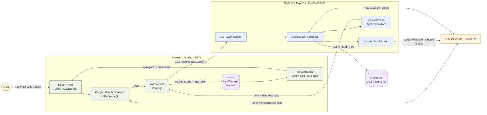
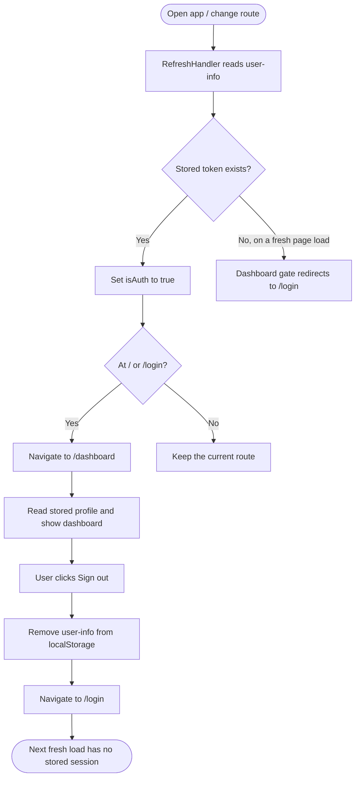

<a id="top"></a>

<div align="center">

# ✳ One — MERN Google OAuth

### One account. A simpler start.

A full-stack Google sign-in project with a calm, responsive interface,<br/>
MongoDB-backed user profiles, and an application JWT issued by Express.


[Overview](#overview) · [Architecture](#architecture) · [Sequence flow](#authentication-sequence-flow) · [Setup](#local-setup) · [API](#api-reference) · [Troubleshooting](#troubleshooting)

</div>

---

## Overview

**One** demonstrates how a React frontend and an Express backend work together to sign users in with Google. Instead of creating another password, users select their Google account, and the server retrieves their profile, finds or creates their MongoDB record, and returns an application token.

The frontend then saves the returned session data and opens a profile dashboard. The project includes a shared page layout, Google sign-in feedback, route navigation, and local sign-out.

> **Implementation scope:** this is a learning project with client-side session persistence. The dashboard gate checks for a stored token; it does not verify the JWT or its expiry. The backend currently has no JWT-protected resource endpoints.

## Features

| Feature | What the project does |
| --- | --- |
| Google sign-in | Uses the OAuth 2.0 authorization-code popup flow through `@react-oauth/google`. |
| Server-side code exchange | Exchanges the authorization code using the Google OAuth client on the backend. |
| User persistence | Finds an existing user by email or creates a new MongoDB document. |
| Application JWT | Signs a token containing the MongoDB user ID with a configured expiry. |
| Profile dashboard | Shows the user's name, email, profile image, and Google connection label. |
| Local session persistence | Stores profile fields and the application JWT under `user-info` in `localStorage`. |
| Sign-out | Removes the stored session data and returns to the login page. |
| Sign-in feedback | Includes a loading spinner, disabled button while signing in, and inline errors. |
| Responsive UI | Uses warm neutrals, green accents, shared layout components, and mobile styles. |
| Accessible details | Includes keyboard focus styles, status/error semantics, avatar fallback, and reduced-motion support. |
| Fallback page | Provides a styled page for unknown routes. |

## Tech stack

| Layer | Technology | Responsibility |
| --- | --- | --- |
| Frontend | React 19 | Component-based login, dashboard, and page UI |
| Development & bundling | Vite 8 | Local development server and production frontend build |
| Routing | React Router DOM 7 | Login, dashboard, fallback routes, and navigation |
| Google browser integration | `@react-oauth/google` | Provider configuration and authorization-code popup |
| HTTP client | Axios | Browser-to-backend requests and backend-to-Google profile requests |
| Backend runtime | Node.js | Runs the Express API |
| API framework | Express 5 | Route handling and JSON responses |
| Database | MongoDB | Stores user profile documents |
| Data modeling | Mongoose 9 | User schema, email lookup, and document creation |
| Google server integration | `googleapis` | OAuth client setup and code-to-token exchange |
| Application tokens | `jsonwebtoken` | Issues an application JWT |
| Configuration | `dotenv` | Loads backend environment variables |
| Cross-origin requests | `cors` | Enables browser access to the backend |
| Backend development | Nodemon | Restarts the API when files change |
| Styling | CSS + Google Fonts | Responsive layout, DM Sans, and Manrope |
| Code quality | ESLint | Frontend lint checks |

Exact dependency ranges are recorded in [client/package.json](client/package.json) and [server/package.json](server/package.json); lockfiles record the installed dependency graph.

## Architecture

The browser handles the popup and UI. The backend handles the Google client secret, token exchange, database access, and application JWT signing.



**[Explore the architecture interactively][architecture-live]**

<details>
<summary><strong>Read the architecture by responsibility</strong></summary>

- **React + Google Identity Services:** starts the popup and receives a temporary authorization code.
- **Axios:** sends that code to the Express endpoint.
- **Express controller:** exchanges the code, fetches the Google profile, and finds or creates the user.
- **MongoDB:** stores the application user profile, including a unique email.
- **JWT signer:** produces the application's token using the database user ID.
- **Browser storage:** persists the returned profile and application token.
- **RefreshHandler:** reads the stored token to update client auth state and redirect login/root visits to the dashboard.

The Google access token and the application's JWT serve different purposes: the former fetches the Google profile on the server; the latter is returned to this application's frontend.

</details>

## Authentication sequence flow

The numbered sequence below follows the actual controller and frontend callback, including first-time and returning users.

```mermaid
sequenceDiagram
    autonumber
    actor User
    participant React as React App (Vite)
    participant Google as Google OAuth / UserInfo
    participant API as Express API (3001)
    participant DB as MongoDB
    participant Storage as Browser Storage

    User->>React: Click "Continue with Google"
    React->>Google: Open authorization-code popup
    User->>Google: Select account and approve consent
    Google-->>React: onSuccess({ code })
    Note over User,React: Popup closes; React continues the request
    React->>API: GET /auth/google?code=...

    alt Missing or empty code
        API-->>React: 400 · Authorization code is required
        React-->>User: Show sign-in error
    else Authorization code provided
        API->>Google: oauth2client.getToken(code)
        Google-->>API: Google OAuth tokens
        API->>Google: GET /oauth2/v1/userinfo + Bearer access token
        Google-->>API: email, name, picture
        API->>DB: UserModel.findOne({ email })
        DB-->>API: User document or null

        alt First sign-in
            API->>DB: UserModel.create({ name, email, image })
            DB-->>API: New user document
        else Returning user
            Note over API,DB: Reuse the existing user document
        end

        API->>API: Sign app JWT with user _id and expiry
        API-->>React: 200 · { message, token, user }
        React->>Storage: Save user-info (email, name, image, token)
        React->>React: Navigate to /dashboard
        React->>Storage: RefreshHandler reads stored token
        React->>React: Set client auth state
        React-->>User: Display profile dashboard
    end

    Note over Google,API: An exception during code exchange, profile lookup,<br/>database access, or JWT signing returns HTTP 500.
    Note over React,API: Google access token stays on the server.<br/>The application JWT is returned to the browser.
```

**[Explore the sequence interactively][sequence-live]**

<details>
<summary><strong>Step-by-step explanation</strong></summary>

1. A user clicks **Continue with Google** on `/login`.
2. `useGoogleLogin({ flow: 'auth-code' })` opens Google's account/consent popup.
3. Google returns an authorization code to the React success callback.
4. `googleAuth(code)` sends `GET /auth/google` with the code as a query parameter.
5. The controller rejects a missing or empty code with HTTP `400`.
6. `oauth2client.getToken(code)` exchanges the code for Google OAuth tokens.
7. Axios requests the Google UserInfo endpoint using the Google access token.
8. The controller extracts `email`, `name`, and `picture`.
9. Mongoose looks up the email. A missing user is created; an existing user is reused.
10. The server signs an application JWT with the user's `_id` and the configured expiry.
11. The API returns `{ message, token, user }`.
12. React stores selected profile fields and the JWT, then navigates to `/dashboard`.
13. `RefreshHandler` reads the stored token and updates client auth state.
14. The dashboard displays the saved profile. Sign-out removes the local session.

If an operation inside the controller throws, the catch block returns HTTP `500`; the login page displays the returned error.

</details>

### Session and sign-out flow



The current sign-out action clears browser storage; it does not revoke the Google authorization or invalidate a JWT on the server. `RefreshHandler` currently sets auth state when a token exists but does not explicitly reset that state when storage is empty. A fresh page load starts with `isAuth = false`.

> **About the diagrams:** GitHub renders the Mermaid blocks directly in this README. The interactive links open preloaded copies in [Mermaid Live](https://mermaid.live/) for closer inspection and editing. Viewer controls depend on where the diagram is opened; custom JavaScript widgets are not embedded in the Markdown.

## Folder structure

```text
MERN-Google-OAuth/
├── README.md
├── client/
│   ├── public/
│   │   ├── favicon.svg           # Custom app icon
│   │   └── icons.svg
│   ├── src/
│   │   ├── components/
│   │   │   ├── AppShell.jsx      # Shared header, content area, and footer
│   │   │   ├── GoogleLogin.jsx   # Google popup, API call, session save
│   │   │   ├── Dashboard.jsx     # Profile display and local sign-out
│   │   │   ├── RefreshHandler.jsx # Stored-token check and redirects
│   │   │   └── PageNotFound.jsx  # Unknown-route fallback
│   │   ├── api.js               # Axios instance and googleAuth helper
│   │   ├── App.jsx              # Routes, provider, and client auth state
│   │   ├── App.css              # Shared UI and component styles
│   │   ├── index.css            # Base styles and font imports
│   │   └── main.jsx             # React entry point
│   ├── index.html               # Page title, metadata, and root element
│   ├── vite.config.js           # React plugin and development COOP header
│   ├── eslint.config.js
│   ├── package.json
│   └── package-lock.json
└── server/
    ├── controllers/
    │   └── googleLogin.js       # Validate code, fetch profile, issue JWT
    ├── models/
    │   └── userModel.js         # Mongoose user schema
    ├── routes/
    │   └── authRouter.js        # /auth/test and /auth/google
    ├── utils/
    │   └── googleConfig.js      # Server-side Google OAuth2 client
    ├── .env.example             # Configuration template; no real secrets
    ├── .env                     # Local configuration; ignored by Git
    ├── server.js                # Express setup and MongoDB connection
    ├── package.json
    └── package-lock.json
```

Dependency folders and generated build files are omitted for clarity. The clone directory is normally named `MERN-Google-OAuth`; a differently named local folder works too.

## Local setup

### 1. Prerequisites

- Node.js **22.12+** and npm. The installed Vite package accepts Node `^20.19.0 || >=22.12.0`.
- A running local MongoDB instance or a MongoDB Atlas connection string.
- A Google Cloud project with a **Web application** OAuth client.
- Two terminals: one for the backend and one for the frontend.

### 2. Clone and install

```bash
git clone https://github.com/Kumar-Shivam01/MERN-Google-OAuth.git
cd MERN-Google-OAuth

npm ci --prefix server
npm ci --prefix client
```

The repository has separate packages. There is no root `package.json` or combined start command.

### 3. Configure Google OAuth

1. Open [Google Cloud Console](https://console.cloud.google.com/) and select or create a project.
2. Configure the Google Auth Platform consent settings, audience, and requested access.
3. Create an OAuth client with application type **Web application**.
4. Add `http://localhost:5173` as an **Authorized JavaScript origin**.
5. If the app is in testing mode, add the Google accounts you will use as test users where required.
6. Put the client ID and client secret in the backend environment file.
7. Replace the `GoogleOAuthProvider` client ID in [client/src/App.jsx](client/src/App.jsx) with the **same client ID**.

The current implementation uses a popup callback rather than an Express redirect callback route. Its server-side OAuth client uses the `postmessage` redirect value in [server/utils/googleConfig.js](server/utils/googleConfig.js); there is no `/auth/google/callback` route in this project.

If adapting the flow or resolving redirect settings, consult Google's [code-model guide](https://developers.google.com/identity/oauth2/web/guides/use-code-model) and keep the browser configuration and token-exchange redirect value consistent.

### 4. Configure the backend

Copy [server/.env.example](server/.env.example) to `server/.env`.

**PowerShell**

```powershell
Copy-Item server/.env.example server/.env
```

**macOS / Linux**

```bash
cp server/.env.example server/.env
```

Then fill in your own values:

```dotenv
PORT=3001
GOOGLE_CLIENT_ID=your-google-client-id.apps.googleusercontent.com
GOOGLE_CLIENT_SECRET=your-google-client-secret
DB_URL=mongodb://127.0.0.1:27017/mern_google_oauth
JWT_SECRET=replace-with-a-long-random-secret
JWT_TIMEOUT=7d
```

| Variable | Used for |
| --- | --- |
| `PORT` | Express port. Use `3001` to match the current frontend API URL. |
| `GOOGLE_CLIENT_ID` | OAuth client ID, matching the frontend provider. |
| `GOOGLE_CLIENT_SECRET` | Server-side Google token exchange. |
| `DB_URL` | MongoDB connection URI; use your Atlas URI if applicable. |
| `JWT_SECRET` | Signs the application's JWT. |
| `JWT_TIMEOUT` | Token lifetime passed to `jsonwebtoken`, for example `7d`. |

The example values are placeholders. The Google client ID is a public identifier; the Google client secret, database credentials, and JWT secret belong only in backend configuration. The server ignores `.env` through its existing `.gitignore`.

### 5. Start the backend

In the first terminal:

```bash
cd server
npm start
```

Look for both messages:

```text
server running on: http://localhost:3001
db connected successfully!
```

The API starts listening before the database connection completes, so the first message alone does not confirm database readiness. If `PORT` is omitted, the server defaults to `8080`, which does not match the current Axios configuration.

### 6. Start the frontend

In the second terminal, from the repository root:

```bash
cd client
npm run dev -- --port 5173 --strictPort
```

Open **[http://localhost:5173](http://localhost:5173)** and select **Continue with Google**.

Using a fixed port keeps the frontend origin consistent with Google Cloud settings. The Axios base URL is currently set directly in [client/src/api.js](client/src/api.js):

```js
baseURL: 'http://localhost:3001/auth'
```

If you change the API port, update that URL too.

## Routes and API reference

### Frontend routes

| Path | Behavior |
| --- | --- |
| `/` | Redirects to login; a stored token can subsequently trigger a dashboard redirect. |
| `/login` | Shows the Google sign-in card. Stored-token visits are redirected by `RefreshHandler`. |
| `/dashboard` | Shows the profile when client auth state is true; otherwise redirects to login. |
| Any other path | Shows the 404 page. |

### Backend endpoints

| Method | Endpoint | Response |
| --- | --- | --- |
| `GET` | `/` | HTML greeting: `HELLO WORLD!` |
| `GET` | `/auth/test` | Plain text: `test passed!` |
| `GET` | `/auth/google?code=...` | Exchanges a Google authorization code and returns the user and application JWT. |

Quick connectivity check: open **[http://localhost:3001/auth/test](http://localhost:3001/auth/test)**. This checks routing, not MongoDB or Google connectivity.

<details>
<summary><strong>Successful authentication response — HTTP 200</strong></summary>

```json
{
  "message": "Success",
  "token": "<application-jwt>",
  "user": {
    "_id": "<mongodb-user-id>",
    "name": "Alex Morgan",
    "email": "alex@example.com",
    "image": "https://example.com/profile-photo.jpg",
    "__v": 0
  }
}
```

The values above are illustrative. The returned `user` comes from the Mongoose document.

</details>

<details>
<summary><strong>Missing authorization code — HTTP 400</strong></summary>

```json
{
  "message": "Google authorization code is required"
}
```

</details>

<details>
<summary><strong>Controller exception — HTTP 500</strong></summary>

```json
{
  "message": "Internal server error",
  "error": "<underlying error message>"
}
```

The current controller uses this same response status for Google token failures, profile-fetch failures, database errors, and JWT-signing errors.

</details>

## Data and session storage

### MongoDB user document

| Field | Schema type | Notes |
| --- | --- | --- |
| `_id` | ObjectId | Generated by MongoDB/Mongoose. |
| `name` | String | Initially copied from the Google profile. |
| `email` | String | Declared unique; used to look up returning users. |
| `image` | String | Initially copied from Google's `picture` field. |
| `__v` | Number | Mongoose version key. |

The model is named `user`. The schema does not define password fields, roles, or timestamps. Returning users reuse the stored profile; the controller does not currently refresh their name or image from Google.

### Browser session

**Storage key:** `user-info`

```json
{
  "email": "alex@example.com",
  "name": "Alex Morgan",
  "image": "https://example.com/profile-photo.jpg",
  "token": "<application-jwt>"
}
```

The application JWT is signed with `{ _id }` and an expiry. The frontend currently checks only whether a stored token exists, and no API helper automatically attaches that JWT to subsequent requests.

## Available commands

Run commands inside the corresponding package folder.

| Folder | Command | Purpose |
| --- | --- | --- |
| `client` | `npm run dev` | Start the Vite development server. |
| `client` | `npm run build` | Generate production frontend assets in `client/dist`. |
| `client` | `npm run preview` | Preview the frontend production build locally. |
| `client` | `npm run lint` | Run ESLint on the frontend. |
| `server` | `npm start` | Start Express with Nodemon. |
| `server` | `node server.js` | Start Express without the development watcher. |

The backend's `npm test` script is currently a placeholder that exits with an error; no automated integration suite is configured.

## Troubleshooting

<details>
<summary><strong>Axios network error or an unreachable backend</strong></summary>

Confirm that Express is running on `3001`, then open `http://localhost:3001/auth/test`. The current API base URL must include **both the correct port and `/auth`**.

- Correct request: `http://localhost:3001/auth/google?code=...`
- A different port reaches a different service or no service.
- Omitting `/auth` targets a route that this server does not expose.

</details>

<details>
<summary><strong>COOP warning about window.closed</strong></summary>

Google's popup library can check whether the popup has closed, which can trigger a Cross-Origin-Opener-Policy warning. The warning alone does not identify a failed backend request.

The Vite development server is configured to send:

```http
Cross-Origin-Opener-Policy: same-origin-allow-popups
```

Restart Vite after changing its configuration. A production frontend host needs its own response-header configuration; the Vite development setting does not configure that host.

If the popup closes after account selection, inspect the subsequent `/auth/google` request and the inline sign-in error. See [Google's setup guidance](https://developers.google.com/identity/gsi/web/guides/get-google-api-clientid).

</details>

<details>
<summary><strong>Google origin, consent, or redirect errors</strong></summary>

Check that the provider and server use the same OAuth client ID, that `http://localhost:5173` is registered as an authorized origin, and that your account is allowed by the app's consent/testing configuration. Use a fresh sign-in attempt instead of manually replaying an old authorization code.

The popup code flow and a server redirect flow have different configuration requirements. This codebase currently uses a popup and the server OAuth client's `postmessage` value.

</details>

<details>
<summary><strong>Sign-in hangs or returns HTTP 500</strong></summary>

Check the API response's `error` field and the backend terminal. Verify the database connection, Google credentials, and JWT environment values. Database operations can wait while MongoDB is unavailable because the API listener starts before database connection success.

</details>

<details>
<summary><strong>Frontend changes are missing or a saved session behaves unexpectedly</strong></summary>

Refresh the page and confirm you are viewing the running Vite app. If testing with an old or malformed local session, remove the `user-info` entry in browser developer tools and sign in again.

The current dashboard gate does not verify token validity or expiry, and session state is not synchronized across browser tabs.

</details>

## Current boundaries and next steps

This implementation covers sign-in and local profile display. Useful extensions include server-side JWT verification for private endpoints, reliable expiry handling, explicit auth-state reset on sign-out, and centralized frontend auth state.

For deployment, move the frontend's API URL and OAuth client ID into environment-based configuration, restrict CORS to the intended frontend origin, configure SPA route fallback and frontend headers on the host, and choose an appropriate session-storage strategy. The active Express middleware is currently `app.use(cors())`; the separate `cors({ ... })` call below it is not mounted.

## References

- [Google Identity Services: authorization code model](https://developers.google.com/identity/oauth2/web/guides/use-code-model)
- [Google Identity Services: setup and popup policy](https://developers.google.com/identity/gsi/web/guides/get-google-api-clientid)
- [GitHub: Mermaid diagrams in Markdown](https://docs.github.com/en/get-started/writing-on-github/working-with-advanced-formatting/creating-diagrams)
- [Mermaid Live Editor](https://mermaid.live/)

---

<div align="center">

**Built with React, Express, MongoDB, and a simpler way to sign in.**

[Back to top](#top)

</div>

[architecture-live]: https://mermaid.live/edit#pako:eNqFVNtu2zgQ_ZUB89LCiu3YcZoa2S7iqtu6abtBEneBtfpAkyOJicwRSKrJbtPv6vt-WUFSvrbF6onEnHNm5sxQX5ggiWzM8oruRcmNg3dXmQYA-KiscmSezDM2s2gy9ulpDNhmURhelzAxdG_RzDPWnuC_b1CR4FVJ1o1HR8-GGfsUSf6bTecZu0IuHHTgo3J4tjC9F--oUBp6kHJbLogbucO5Ti_mGXtNVFQIU4naKfcPXKP5rATaINBYjPGgtMN-c3NzOc_Y-YMiC6JSqF2gWCN6vFbdW7ubzJHB-ZOMhSb8jRe4ymEOlc4pY0-3CK8bbmRoKjdoyzdcywpNYLwM2Q6tkgiGGodQcIfrdKjlnpu-p2DmB5LYvbXQgVcPtUFrd20d9vtHO1VfeXVv0qsb6PHGlb0i2LEDeknaGaqqkKHY2AViHdjB_3neuHLjfLgOWgt3gG__upln7NaSvseFozvUof3zuq6U4E6R9pAf-47CexmgA37XpsHolpFO_ETeky4onQRtDwFJolmidjZOZGdn4fDwxWPGfM9KNwj3ypVtwow9wmwa0bOpB_oVi_fr9ALOIvWS6qaGHng7yah_YyP-rXiBVmpNipxV1C9djPlTG9wfzu8e_Vu32_WMMMFICcdQ1mZiMbK5h3DwK0aidWerpiUCPoiS6wKh19YKYTJ2v_gtzZZ-LoTfuACHHtSGclXh__P-UFoCGRAGuUNowh_jEdLJT4v3G6Hb7WkN8qdO4IFBW5O2vzbzEo1V1q2qgw7wuo41e054xu10_DGkDE-1XT1_bKU-8M_KP0xwBHLzB4pLEuGi4tammENuSDvUEnJVVeMDlPkQTxPrDN3h-OBEnoqTfiKoIjM-GPSHiwHuCSy4uNvi87yf8w2fn44WgzX_eMhHfI-PDw6N5lUrkOf5sczXAuLkuRytBUbieDTo7wnY-Etb8Y-QbxXwnD_DxWjFPz4d9kdiiw-zaXKdXiR-Dkm0cGXINioscLKZdxK2M_HjbdvfRselSlbvdtXgNiSdJHGKbfEsYUs0S64kG7MvGXMlLjFj44xJbu4y9pUlrKkld5gqXhi-ZGNnGkyYoaYo2TjnlcWE1Vz_TdQGv34HTo1HOg
[sequence-live]: https://mermaid.live/edit#pako:eNp9Vdtu4zYQ_ZUBnxxUvuy2fVFbF_Z6u-sCSYzYbYHCQEGTY4mIRKq8OM4a-a6-75cthpRjxYmrJ11m5pyZc4Y6MGEkspw5_DegFjhTvLC8XmsAAB680aHeoG2fhTcW_nDH54Zbr4RquPZwh1x44K69mTQN9P5UHq9eh34ypqiQYtu720nwJQxj5bnemtcpk8Wc4j_uG4vOxcfe96PRuzeqz6YUeW10YWbT15-X3lheRPSpNQ8O7fHVWqdoYtEfj2MfOXyolLiHNftgtFc6IDwoX7bE1yxlxND-eJze5nDboKbhlcaqL9wro_s0ZmhME5oXIMeMJVZI4xPCBO2Bawm8aazZIQijHWqf0lJ8_0TP6GUQAp3rHSBiPLUjuTEeweww6ZW14QtiAKIyDt1PrVSi7cyBLxEsGcH5l41NFvMcPn1cwZC6GhaRxa-E98tgMDgOjlcerpVzShdgLGDd-MdIKn2ma7KYd8j_MBrB1_9g0p1U6kK5SERZlKfkxKY_HlNHOSxL8wBOFbqvNKC1pnUlVg7fqknjVLJbkNicNDDU23tRKdR-UKBfmXvUPUq9OqWcBEgz6RrYU4K7VD6OL2EMd--GwaFVemvgO5git2hJfPJ2rHIREGuuqgw0rzGDRgkfLJ4jzqZ5FP3aSKwGW6XlrcbeIeU-G4Su2fS5MCWANCLUqD3Jp0NVrTtESN3flHX-OPPTp0vQwiL3hJzottxVTfvXpXFG5QYfIHTpnCKjtnfog9XksvB8FB2vk-0ni3lGdO4wOIzWxr1y_pj2VnEtuw2njiKjpSo0LST8_tcqHQCxxD9KxlXFfaPs4yWXv08uP0CNzvECsyRxlmo8nft7PG7PoxyWfIcxqh-d0nshfhxjW-vqdZEW_IbvVME9gjcwlNyVG8Ot_B_MO9xadOVnrmWFFixy6cB5Y1GeW_MMaoke0vbEsw-c5x4vbu9Muabij7SVW1UhnHHraHGSNO1CFiWZaMC9wCbutwyWdI1rjntRck2jOZaujLkPTfbzxg7Hknu-4Q7bbcvI6SQqeZpK2OgtB59XqwX8OBoNzjnENrLu8nf3lpp-dGB0NJxDu0M7iMCrEslBlRLpSCLQeMoRXpxtTNmkf9KAZaxGW3MlWc4Oa-ZLrHHN8jWT3N6v2RPLWGgk98c_Nsu9DZgxa0JRsnzLK4cZa7j-25j249M3pQySVQ
